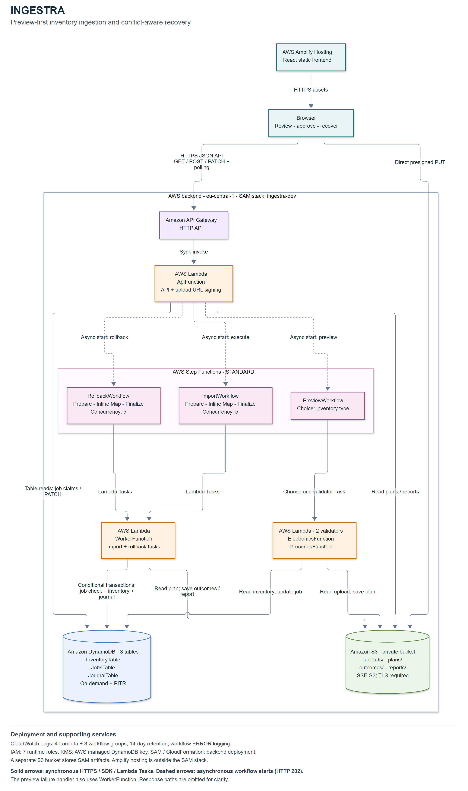

# Ingestra

**Serverless Inventory Ingestion and Conflict-Aware Recovery**

Ingestra helps teams review supplier inventory changes before applying them and recover from an incorrect import without overwriting later work. It combines schema-aware previews, asynchronous processing, atomic per-record change journals, and selective rollback on AWS.

[Open the live application](https://production.d315aol50xxf22.amplifyapp.com/)

The current public deployment uses a shared tenant and an **unauthenticated API**. Anyone who can reach the API can read or modify its inventory. Use non-sensitive sample data.

## Overview

A supplier file can contain invalid records, duplicate SKUs, or quantities that should not replace current stock. Restoring a database snapshot after a bad import can also erase inventory adjustments made afterward. Ingestra addresses this with an explicit preview and approval process, then reverses only changes whose imported versions are still current. Conflicts remain visible for manual reconciliation.

Core capabilities:

- UTF-8 CSV and JSON ingestion, with a 2 MiB file limit and up to 500 records.
- Electronics and groceries schemas with field validation and duplicate detection.
- Preview-first classification: **CREATE, UPDATE, UNCHANGED, INVALID**.
- Approval tied to the exact saved plan through a SHA-256 identifier.
- Separate asynchronous preview, import, and rollback workflows.
- Atomic DynamoDB transactions for each imported record and its change journal.
- Version and revision checks to detect intervening changes and make retries safe.
- Selective rollback that preserves later inventory modifications and reports conflicts.
- Inventory browsing, quantity editing, job progress, journal inspection, and recovery reports.

## AWS serverless architecture

AWS Amplify Hosting serves the React frontend. The browser calls an Amazon API Gateway HTTP API backed by an API Lambda and uploads files directly to private Amazon S3 using short-lived presigned URLs. The API starts three Standard AWS Step Functions workflows. Two validator Lambdas handle inventory-specific previews; a shared worker Lambda handles import and rollback tasks. Three DynamoDB tables store inventory, jobs, and import journals. S3 stores uploads, plans, outcomes, and reports.



[Architecture and workflow details](docs/architecture.md) ? [SVG diagram](docs/architecture.svg) ? [Mermaid source](docs/architecture.mmd)

Step Functions manages type routing, bounded concurrency, retries, and failure handling. Import and rollback use Inline Maps with concurrency five. Workflow starts return HTTP 202; the frontend polls the API for progress. Individual Lambda Tasks are synchronous within each asynchronous workflow. Application job status and counts determine the business result, even when a Step Functions execution ends with `SUCCEEDED`.

### Technology stack

| Layer | Technology |
| --- | --- |
| Frontend | React, TypeScript, Vite, Tailwind CSS |
| API and tasks | Python 3.12, AWS Lambda, boto3 |
| HTTP interface | Amazon API Gateway HTTP API |
| Orchestration | AWS Step Functions Standard |
| Persistence | Amazon DynamoDB and private Amazon S3 |
| Hosting | AWS Amplify Hosting |
| Operations and access | Amazon CloudWatch Logs, AWS IAM, DynamoDB-managed AWS KMS encryption |
| Infrastructure | AWS SAM and AWS CloudFormation |
| Local development and tests | SQLite, pytest, Moto |

## How ingestion and recovery work

1. **Upload and preview.** The API creates a job and returns a presigned PUT URL. After uploading directly to S3, the user explicitly starts preview. A Step Functions Choice selects the electronics or groceries validator. It compares rows with inventory and saves a content-addressed plan without changing inventory.
2. **Approve and import.** Approval supplies the exact `planId`. The import workflow processes the saved plan. For each CREATE or UPDATE, one conditional DynamoDB transaction checks the active job attempt, writes inventory, and creates its journal entry. Invalid and unchanged rows do not write inventory. Each record is atomic; the complete file can have partial results.
3. **Recover selectively.** Rollback compares each current product with its journaled imported **version and revision**. An unchanged imported CREATE can be deleted; an eligible UPDATE can restore the original content with fresh concurrency tokens. Later edits are preserved and reported as conflicts. Repeating recovery recognizes already reversed entries.

Original journal images are preserved by application logic while recovery metadata can change. Ordinary inventory edits use optimistic concurrency but do not create import journal entries. See [transaction and rollback guarantees](docs/correctness.md) and the [API contract](docs/api.md).

## Local development

Requires **Python 3.12** and **Node.js 20.19+ or 22.12+**. The PowerShell examples below run from the repository root. On Linux or macOS, activate the virtual environment with `source .venv/bin/activate` and copy the frontend example with `cp`.

Start the API:

```powershell
python -m venv .venv
.\.venv\Scripts\Activate.ps1
python -m pip install -r requirements-dev.txt
python -m backend.local --seed
```

In a second terminal, configure the frontend for the local API:

```powershell
npm --prefix frontend ci
Copy-Item frontend/.env.example frontend/.env.local
npm --prefix frontend run dev
```

Open **http://localhost:5173**. The local API listens at **http://127.0.0.1:3001**. `frontend/.env.local` must contain `VITE_API_BASE_URL=http://127.0.0.1:3001` for local development; use the deployed API URL when connecting to AWS instead. Restart Vite after changing environment configuration.

Local mode uses SQLite and background threads with the same validation and transaction service. It does not run AWS Step Functions. Data persists in ignored `.local/ingestra.db`; `--seed` creates baseline inventory only when inventory is empty. The root `.env.example` documents process environment settings; the Python server does not automatically load a root `.env` file.

The optional [PowerShell helper](scripts/dev.ps1) supports `api`, `frontend`, `test`, and `validate`, using a local portable Python runtime when available or Python from PATH.

## Try the recovery walkthrough

With a fresh seeded local database:

1. Choose Electronics and upload [samples/electronics.csv](samples/electronics.csv).
2. Start preview: expect **1 CREATE, 2 UPDATE, 1 UNCHANGED, 3 INVALID**.
3. Approve the plan: three writes commit; invalid rows remain reported in the partial result.
4. Edit E100's imported quantity from 100 to **98**.
5. Roll back the supplier import: expect **2 REVERSED / 1 CONFLICT**. E100 stays at 98.
6. Retry recovery: expect **2 ALREADY_REVERSED / 1 CONFLICT**.

[Complete walkthrough and baseline requirements](docs/walkthrough.md) ? [Groceries CSV](samples/groceries.csv) ? [Electronics JSON](samples/electronics.json) ? [Groceries JSON](samples/groceries.json)

## AWS SAM deployment

The backend targets **eu-central-1** and stack **ingestra-dev**. Install AWS CLI v2, authenticate a named profile through your approved method, and follow the [deployment IAM guide](docs/iam/README.md) to provision the dedicated CloudFormation execution role, runtime permissions boundary, policies, and private SAM artifact bucket. Do not attach AdministratorAccess.

Render account-specific files locally, then validate and build the boundary-enabled template:

```powershell
$IngestraAccountId = (aws sts get-caller-identity --profile ingestra --query Account --output text)
python scripts/prepare_deployment_iam.py --account-id $IngestraAccountId
python -m samcli validate --lint --template-file .local/deployment-iam/template.yaml --region eu-central-1
python -m samcli build --template-file .local/deployment-iam/template.yaml --config-file samconfig.toml
```

After the IAM setup and artifact bucket are ready, review and deploy with the dedicated role:

```powershell
$IngestraArtifactBucket = "ingestra-dev-sam-artifacts-$IngestraAccountId-eu-central-1"
$IngestraExecutionRole = "arn:aws:iam::${IngestraAccountId}:role/ingestra-dev-cloudformation-execution"
$IngestraFrontendOrigin = 'http://localhost:5173' # use your exact hosted HTTPS origin for a published frontend
python -m samcli deploy `
  --template-file .aws-sam/build/template.yaml `
  --config-file ../../.local/deployment-iam/samconfig.toml `
  --stack-name ingestra-dev --region eu-central-1 --profile ingestra `
  --s3-bucket $IngestraArtifactBucket --s3-prefix ingestra-dev `
  --role-arn $IngestraExecutionRole --capabilities CAPABILITY_IAM --confirm-changeset `
  --parameter-overrides FrontendOrigin=$IngestraFrontendOrigin DemoTenant=demo-retail
```

Keep rendered policies, account-specific templates, and deployment outputs in ignored `.local/`. The generated SAM configuration is required with these scoped policies: the root configuration enables SAM-managed bucket resolution and must not be combined with the explicit artifact bucket. `--config-file` paths resolve relative to the selected template.

Set the frontend's `VITE_API_BASE_URL` to the stack's `ApiUrl` output and rebuild it. [Amplify Hosting instructions](docs/frontend-hosting.md) explain how to publish the static build and set `FrontendOrigin` for both API and S3 CORS. Hosting is separate from the backend stack.

[Deployment, live checks, and resource cleanup](docs/deployment.md)

## Testing and verification

With development dependencies installed:

```powershell
python -m pytest -q
npm --prefix frontend run build
python -m samcli validate --lint --region eu-central-1
```

Run the SAM build using the boundary-enabled command above. With a local API running, `python scripts/smoke.py` performs read-only endpoint checks; use `--api <ApiUrl>` for an authorized deployed endpoint.

Tests cover both schemas, parsing limits, preview classifications, exact-plan approval, conditional transactions, concurrent changes, retries, partial results, stale workers, and rollback protection. They exercise SQLite and mocked DynamoDB/S3 as well as a local HTTP flow. Mocked tests do not establish deployed IAM, browser-to-S3 behavior, or real Step Functions execution histories. See [verification methods and results](docs/verification.md).

`template.yaml` and the workflow definitions are checked in. [scripts/generate_infra.py](scripts/generate_infra.py) regenerates them together; review generated changes before deployment. The infrastructure generator, IAM renderer, and smoke checker are maintained deployment tools, not application request handlers.

## Security considerations and current limitations

- **No application authentication or tenant authorization.** The public API uses a shared configured tenant. Tenant-prefixed keys and CORS do not isolate users. Do not use confidential inventory data.
- **Per-record guarantees.** Inventory and its import journal commit atomically for each actionable row. Partial imports are supported; rollback reports conflicts for manual reconciliation rather than merging changes.
- **Application-preserved history.** Original import images remain intact, but journal recovery metadata changes. There is no WORM or compliance immutability guarantee.
- **Bounded batches.** Files are limited to 2 MiB and 500 records. API queries return accumulated results rather than exposing pagination; keep the working dataset small.
- **Private storage and scoped runtime access.** The application bucket blocks public access, requires TLS, and uses encryption. Runtime roles limit resource access. There is no API authorizer, WAF, or automatic stuck-job watchdog in the template.
- **Retention and cost.** All `uploads/` objects expire after seven days. Plans, outcomes, reports, DynamoDB records, and enabled PITR can retain data or incur charges until cleaned up. Serverless deployment does not guarantee zero idle cost. Throttling and budget alerts are not spending caps.
- **Credentials stay local.** Environment files, AWS configuration, rendered IAM files, dependency directories, logs, and build outputs are ignored. Only the public API URL belongs in a `VITE_` variable; frontend environment variables are embedded in browser-delivered code.

## Repository layout

| Path | Purpose |
| --- | --- |
| `frontend/` | React application and API client |
| `backend/ingestra/` | Lambda handlers, schemas, shared service, SQLite and AWS adapters |
| `workflows/` | Preview, import, and rollback ASL definitions |
| `template.yaml` | Backend SAM infrastructure |
| `scripts/` | Infrastructure generation, IAM preparation, local launch, read-only smoke checks |
| `samples/` | Baseline and supplier CSV/JSON fixtures |
| `tests/` | Backend, concurrency, HTTP, and deployment-policy tests |
| `docs/` | Architecture, API, correctness, operation, and deployment guides |
