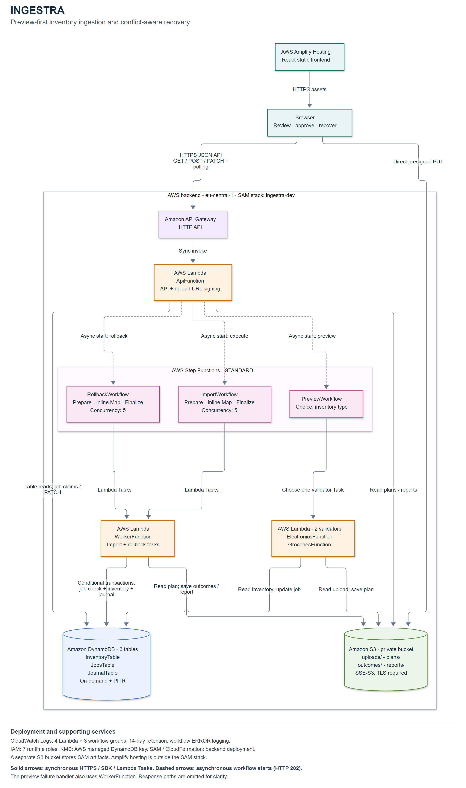

# AWS serverless architecture

Ingestra uses a separately hosted React frontend and an AWS SAM backend for preview-first inventory ingestion and conflict-aware recovery. The diagram and workflow traces describe the implemented source and deployed architecture.

View the [PNG architecture diagram](architecture.png), [scalable SVG](architecture.svg), or [editable Mermaid source](architecture.mmd).

## Architecture diagram

[](architecture.svg)

**Solid arrows** show synchronous HTTPS, SDK, and Lambda Task calls. **Dashed arrows** show asynchronous workflow starts; the API returns HTTP 202 after the start is acknowledged.

Open the [SVG](architecture.svg) to zoom, or edit the [Mermaid source](architecture.mmd) to regenerate the diagram.

The diagram uses logical resource names rather than account IDs or generated physical names. The validators box represents **two functions**, and the DynamoDB box represents **three tables**. Data arrows describe the subsets named on each arrow; they do not grant every function access to every table. Supporting-service relationships, response arrows, and the preview failure handler calling WorkerFunction are described below rather than drawn, to keep the main flow readable. The image includes a supporting-services footer.

Dashed `StartExecution` arrows mean the workflow continues asynchronously after the API responds. The SDK call that starts it still waits for AWS to acknowledge the start; it does not wait for workflow completion. Inside each workflow, the direct Lambda ARN Task integration **waits for the invoked function to finish**. User approval is a separate API call and separate execution, not a waiting callback task inside preview. See [start_workflow and API routing](../backend/ingestra/handler.py#L16), the three workflow definitions below, and [AWS Lambda Task semantics](https://docs.aws.amazon.com/step-functions/latest/dg/connect-lambda.html).

## Services, deployed components, and communication

| AWS service or deployment tool | Actual implementation and communication |
| --- | --- |
| **AWS Amplify Hosting** | Separately published React/TypeScript/Vite static frontend; serves HTML, CSS, and JavaScript to the browser. The browser calls the backend directly. Amplify is outside `template.yaml` and the backend stack. Its managed CDN uses Amazon CloudFront; no separately configured CloudFront distribution is declared in this repository. See [hosting configuration](frontend-hosting.md) and [AWS Hosting documentation](https://aws.amazon.com/amplify/hosting/). |
| **Amazon API Gateway HTTP API** | `HttpApi`; proxies `ANY /{proxy+}` to `ApiFunction`. JSON GET/POST/PATCH calls, exact-origin CORS, default throttle 10 requests/second and burst 20. The Lambda responds to OPTIONS with 204. No authorizer, API keys, or application authentication. |
| **AWS Lambda** | Four Python 3.12 functions: `ApiFunction` (`handler.api`), `ElectronicsFunction` (`handler.electronics_validator`), `GroceriesFunction` (`handler.groceries_validator`), and `WorkerFunction` (`handler.worker`). Each has 512 MiB memory and a 60-second timeout. API Lambda accesses DynamoDB/S3 and calls Step Functions `StartExecution`; workflow Tasks invoke the validators or worker. |
| **AWS Step Functions** | Three `STANDARD` state machines: `PreviewWorkflow`, `ImportWorkflow`, and `RollbackWorkflow`. Preview uses a Choice; import and rollback use separate Inline Maps with `MaxConcurrency: 5`. They call Lambda, not DynamoDB or S3 through direct service-integration Tasks. Task retries use `States.TaskFailed`, 2-second initial interval, backoff 2, `MaxAttempts: 3`; Catch handlers record business failure/reconcile outcomes. |
| **Amazon S3: application bucket** | One private `UploadBucket` shared by `uploads/`, `plans/`, `outcomes/`, and `reports/` prefixes. Browser uses presigned PUT only; validators read uploads and conditionally create plans; worker reads plans and writes outcomes/reports; API reads plans/reports for display. Block Public Access, SSE-S3/AES256 encryption, TLS-only bucket policy, and exact-origin PUT CORS are configured. Lifecycle expires **all objects under `uploads/` after seven days**, including files already processed. Other prefixes have no lifecycle expiration configured. |
| **Amazon DynamoDB** | Three tables: `InventoryTable`, `JobsTable`, `JournalTable`. AWS adapter uses strongly consistent GetItem/Query, internally paginates Query, and calls `TransactWriteItems` for conditional writes. On-demand billing, server-side encryption and PITR are enabled on all three. No Streams or GSIs are configured. |
| **AWS Key Management Service** | DynamoDB `SSEEnabled: true`, with no custom key ID, selects the AWS managed DynamoDB KMS key. This is managed encryption used by DynamoDB; application handlers do not directly call KMS and the stack creates no customer managed key. S3 uses SSE-S3 instead. See [AWS SSESpecification semantics](https://docs.aws.amazon.com/AWSCloudFormation/latest/TemplateReference/aws-properties-dynamodb-table-ssespecification.html). |
| **Amazon CloudWatch Logs** | Seven explicitly declared log groups: four Lambda groups and three workflow groups, all with 14-day retention. Step Functions logging is `ERROR` with `IncludeExecutionData: false`. Lambda error paths use Python logging. API access logging, X-Ray tracing, custom dashboards, and alarms are not configured by the template. |
| **AWS IAM** | SAM generates four Lambda execution roles and three state-machine roles. Runtime policies scope table actions, S3 prefixes, workflow starts, and Lambda invocations. The prepared deployment template adds a permissions boundary to all seven generated roles. The dedicated CloudFormation execution role and deployment IAM policies are configured separately from the application stack. See [IAM guide](iam/README.md) and [template-copy generator](../scripts/prepare_deployment_iam.py#L203). |
| **AWS SAM / AWS CloudFormation** | SAM is the deployment tool/transform; CloudFormation provisions the backend stack. The prepared commands deploy the boundary-enabled template using the dedicated execution role in `eu-central-1`. The separate private SAM artifact S3 bucket holds deployment ZIPs/templates; it is **not** the application upload bucket and is outside the request path. No CI/CD pipeline or container registry is configured. |

Infrastructure source: [template.yaml](../template.yaml), [root SAM configuration](../samconfig.toml), [deployment instructions](deployment.md), and [prepared IAM deployment instructions](iam/README.md). Amplify publication is documented separately in [frontend hosting](frontend-hosting.md).

### DynamoDB keys and authoritative state

| Logical table | Partition key (`PK`) | Sort key (`SK`) | Stored information |
| --- | --- | --- | --- |
| `InventoryTable` | `tenantId#inventoryType` | SKU | Validated product fields, tenant/type, integer `version`, random UUID `revision`, timestamps. Both inventory types share this table. |
| `JobsTable` | Tenant ID | Job ID | Filename, upload key, business status, active attempt/action, plan key/digest, approved digest, counts, report keys. |
| `JournalTable` | Job ID | SKU | CREATE/UPDATE operation, deterministic operation ID, original before/after images and versions, COMMITTED import marker, recovery status and metadata. |

Source: [resource_key](../backend/ingestra/common/model.py), [Service](../backend/ingestra/common/service.py), and [AwsStore](../backend/ingestra/common/store.py#L79). `JobsTable.status` and outcome counts are the application result; the UI does not infer business success from a Step Functions execution label.

## End-to-end workflow 1: CSV/JSON upload and preview

1. React calls **POST `/imports`** with inventory type, filename, and byte size. `Service.create_job` validates type/extension/size and conditionally creates an `UPLOADING` job. API Lambda returns HTTP **201**, the job, a presigned S3 PUT URL valid for 300 seconds, and required upload headers. Presigning occurs in Lambda using its role credentials; it does not upload the file or pass AWS credentials to the browser.
2. The browser **PUTs the file directly to S3**, using `application/octet-stream` and `x-amz-server-side-encryption: AES256`. SigV4 signs the declared Content-Length as well. The API does not proxy file bytes. No S3 event starts processing. Inputs are UTF-8 CSV or a JSON array of objects, limited to **2 MiB and 500 records**; backend parsing and object-size checks enforce the limits too.
3. The user explicitly starts **POST `/imports/{jobId}/preview`**. The API conditionally changes the job to `PREVIEWING`, generates an attempt token, and calls `StartExecution` on `PreviewWorkflow`. The workflow receives only job/attempt/action/type references. API returns HTTP **202** without waiting for validation.
4. `InventoryType` Choice dispatches to **ElectronicsFunction** or **GroceriesFunction**. Shared parsing validates required fields and duplicates; inventory-specific validation checks optional warranty/serial fields or expiry-date format. The validator reads current inventory and classifies each row as **CREATE, UPDATE, UNCHANGED, or INVALID**, capturing a before-image and expected version/revision or expected absence.
5. The validator serializes the complete plan, computes its **SHA-256** digest, and conditionally creates `plans/{tenant}/{jobId}/{digest}.json` using `IfNoneMatch: '*'`. It records the plan key, digest, counts, and `PREVIEW_READY` in JobsTable. **Inventory and the import journal are not modified by preview.** Invalid rows remain visible in the plan; malformed files can produce `PREVIEW_FAILED`.
6. React polls the API every **1.5 seconds while a job is running**, fetches the plan through GET `/imports/{jobId}/plan`, and presents it for approval. Plans are read through Lambda, not through public S3 GET access.

Code: [frontend upload/polling](../frontend/src/main.tsx#L23), [API routes and presigning](../backend/ingestra/handler.py#L39), [job claim and preview](../backend/ingestra/common/service.py#L32), [S3 adapter](../backend/ingestra/common/store.py#L141), [parsing](../backend/ingestra/validators/common.py), [electronics schema](../backend/ingestra/validators/electronics.py), [groceries schema](../backend/ingestra/validators/groceries.py), [preview ASL](../workflows/preview.asl.json).

## End-to-end workflow 2: approved inventory import and journaling

1. Approval calls **POST `/imports/{jobId}/execute`** with the exact `planId`. The job must be `PREVIEW_READY`; the API compares the submitted identifier with `JobsTable.planId`, records `approvedPlanId`, conditionally changes status to `IMPORTING`, assigns an attempt token, and starts **ImportWorkflow**. The API returns **202**. Repeat calls during the same running attempt use an identical named execution/input rather than starting a second independent attempt.
2. **Prepare** invokes WorkerFunction, checks current job status/attempt, reads the approved S3 plan, recomputes its digest, and returns its row indexes. **ProcessRecords** is an Inline Map over these references with concurrency five. Full supplier data, plans, and reports remain outside the state payload in S3.
3. For a CREATE or UPDATE, WorkerFunction prepares a new product revision and journal images. **One DynamoDB transaction per actionable row** performs all three operations:
   - JobsTable `ConditionCheck`: status is `IMPORTING` and the attempt is still active.
   - InventoryTable conditional `Put`: key must be absent for CREATE, or current version **and revision** must equal the preview expectation for UPDATE.
   - JournalTable conditional `Put`: no existing `(jobId, sku)` entry, containing `beforeImage`, `afterImage`, versions, `importStatus: COMMITTED`, `rollbackStatus: PENDING`, and SHA-256-derived `operationId`.
4. That row's inventory change and journal record commit together or neither commits. Other rows are independent: the file is **not one global transaction**. Concurrent changes cause `CONFLICT`. INVALID and UNCHANGED rows write outcomes without modifying inventory or creating journal entries.
5. A retry first checks the strongly consistent journal; an existing commit proves the inventory write already happened. Conditional journal creation handles competing retries. Record-failure reconciliation checks the journal after exhausted task retries to recognize commits whose responses were lost. Outcomes go to `outcomes/{jobId}/{attempt}/{hash(ref)}.json`.
6. **Finalize** reads outcomes, writes `reports/{jobId}/{attempt}.json`, and conditionally updates JobsTable counts/status. Conflicts, invalid rows, or failed rows produce `PARTIAL`; otherwise `COMPLETED`. The UI polls and reads results through the API. A workflow-level failure records `FAILED` when its failure handler can run; committed journals remain recoverable.

Code: [claim/plan verification](../backend/ingestra/common/service.py#L55), [prepare/outcomes/import transaction](../backend/ingestra/common/service.py#L117), [failure reconciliation and finalization](../backend/ingestra/common/service.py#L193), [DynamoDB transaction adapter](../backend/ingestra/common/store.py#L112), [worker dispatch](../backend/ingestra/handler.py#L136), [import ASL](../workflows/import.asl.json).

## End-to-end workflow 3: conflict-aware rollback

1. The user requests **POST `/imports/{jobId}/rollback`**. An executed import with a valid approved plan can be recovered after completion, partial success, or failure, and recovery can be retried. The API conditionally claims a `ROLLING_BACK` attempt, starts **RollbackWorkflow**, and returns **202**.
2. **Prepare** reads that import's journal keys. Its separate Inline Map invokes the same WorkerFunction with `action: rollback`, concurrency five. Previously reversed entries return **ALREADY_REVERSED** without an inventory write.
3. For each committed journal entry, a transaction checks the active rollback attempt, matches current inventory against the imported after-image's **version and revision**, and conditionally updates journal recovery status together with the reversal:
   - Imported **CREATE**: delete the product only if it still matches that after-image.
   - Imported **UPDATE**: restore the before-image's product content, but set version to the imported version plus one and generate a fresh revision. The earlier version number is not restored.
4. A later PATCH or another import changes the concurrency tokens, so the reversal transaction fails without overwriting that product. A missing product or deleted/recreated SKU also conflicts; the random revision detects a recreated item even if its numeric version is the same. The worker records **CONFLICT** for manual reconciliation. It does not merge changes or decide whether a later edit is legitimate business activity.
5. A successful reversal and its `REVERSED` journal marker commit atomically. Original before/after images and operation history remain; only recovery metadata changes. Repeating recovery recognizes already reversed entries. A lost task response is reconciled against the journal. Finalization stores a report/counts and sets `ROLLED_BACK` or `ROLLBACK_PARTIAL`; infrastructure failures can produce `ROLLBACK_FAILED`.

Code: [rollback transaction](../backend/ingestra/common/service.py#L160), [optimistic inventory PATCH](../backend/ingestra/common/service.py#L242), [rollback ASL](../workflows/rollback.asl.json), and [correctness design](correctness.md). Existing tests cover employee edits, missing items, deleted/recreated items, older imports, partial failure, retries, and stale worker fencing in [test_ingestra.py](../tests/test_ingestra.py#L89); [test_handlers.py](../tests/test_handlers.py#L84) covers lost-response reconciliation. These tests use SQLite and mocked AWS adapters, not live workflow execution histories.

### Concrete recovery example

With a fresh baseline, `samples/electronics.csv` proposes one CREATE, two UPDATEs, one UNCHANGED row, and three INVALID rows. Three writes commit. After an employee-style PATCH changes E100 from the imported quantity 100 to 98, rollback leaves **E100 at 98**, restores **E300 to 15**, and removes import-created **E400**: **2 REVERSED / 1 CONFLICT**. A retry reports **2 ALREADY_REVERSED / 1 CONFLICT**. This expected scenario is asserted in [the sample tests](../tests/test_ingestra.py#L227) and [local HTTP integration test](../tests/test_http.py#L14); it is not newly claimed as a live AWS test during this review.

## Why these design choices matter

- **Step Functions:** keeps preview, import, and recovery separate and observable, runs type selection and bounded record concurrency, and provides explicit retries and failure paths. The browser receives 202 rather than holding one request open for the whole file. Task success and business success are distinct: failure-handler Tasks end normally, and validators can return a failure status without raising. A Step Functions `SUCCEEDED` execution can therefore coexist with `PREVIEW_FAILED`, `FAILED`, `PARTIAL`, or recovery failure in the job. Use JobsTable status/counts to judge the business result.
- **DynamoDB conditional transactions:** prevent inventory from being committed without its import journal, fence stale attempts inside the same transaction, reject concurrent resource changes, and let retrying workers recognize prior commits. Strong reads assist reconciliation; the transaction conditions provide the final concurrency guarantee.
- **Version-aware recovery with revision tokens:** tests the current product against the exact imported state before compensating. The version tracks mutations; the random revision also protects against delete/recreate and stale-history collisions. A safe restore produces fresh concurrency tokens, preventing an older import from treating the restored item as its untouched after-image.
- **S3 plan persistence:** keeps bulk data out of workflow payloads. Exact-plan approval, digest verification, and conditional plan creation prevent retries or reuse of an upload URL from silently changing an approved plan. These are application safeguards, not S3 Object Lock or a WORM guarantee.

## Deployment boundaries

The SAM template defaults `FrontendOrigin` to localhost. For hosted use, set it to the exact Amplify origin for both API and S3 CORS. The prepared deployment template adds the runtime boundary without changing application resources or workflow logic. The API URL is embedded into the frontend at build time through `VITE_API_BASE_URL`.

The backend stack does not own the Amplify app or the separate SAM artifact bucket. Keep account-specific policies, resource identifiers, execution records, and operational reports in ignored local storage. [Deployment instructions](deployment.md), [IAM setup](iam/README.md), and [frontend hosting](frontend-hosting.md) document those responsibilities.

Local mode uses SQLite and background threads with the same domain service. It does not execute AWS Step Functions. The public API has no authentication or tenant authorization; CORS and tenant-prefixed keys are not user isolation. Limits are 2 MiB and 500 records per file. No WAF, watchdog, or automatic conflict merging is configured.

## Diagram source and verification

Use [Mermaid CLI](https://github.com/mermaid-js/mermaid-cli) to regenerate the core diagram:

```powershell
npx --yes --package @mermaid-js/mermaid-cli mmdc -i docs/architecture.mmd -o docs/architecture.svg -b white
npx --yes --package @mermaid-js/mermaid-cli mmdc -i docs/architecture.mmd -o docs/architecture.png -b white -s 2
```

The provided vector and PNG exports also include a title and a supporting-services legend. The PNG is 2488 x 4200 pixels. Supporting notes summarize IAM, CloudWatch Logs, KMS encryption, and deployment artifacts without adding new application services.

See [verification methods and results](verification.md) for local checks and their limits. Integration tests with mocked services do not establish live IAM authorization or complete hosted workflow behavior.
